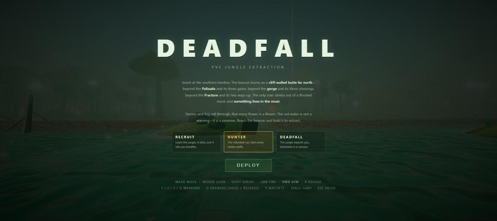

# Deadfall

**A first-person PVE extraction shooter in an Amazonian fever-dream that hunts you back - in your browser.**

One run. No second chances. 
The jungle is awake, and it knows you are here. 
Find your way north to the beacon, and get out alive.

## Play

Requirements: Windows 10 or 11 and a modern browser.

1. Click the green Code button, choose Download ZIP, and unzip it.
2. Double-click `scripts\launch.bat`.

If Windows warns about an unknown publisher, click More info, then Run anyway.

**Updating:** double-click `scripts\update.bat`.

## Controls

WASD move · mouse look · **RMB aim down sights** · Shift sprint · LMB fire · R reload · 1/2/3/Q weapons · G grenade (hold to arc, release to throw) · V machete · Space jump · ESC pause

## Difficulties

Three difficulties: **RECRUIT** (learn the jungle), **HUNTER** (the intended run), **DEADFALL** (extraction is a rumour).

## What awaits you

- Geography is the antagonist: mountain walls, a flooded gorge and cliffs force every route into a choice.
- The Miremother, an apex serpent that guards the drowned stair to extraction.
- Live weather that plays: storms hide your gunfire, fog ruins the hunters' tracking.
- A deceptive jungle of flowers, bone traps and dart totems that punish trust.
- Six hunters, each with a tell and a weakpoint worth finding.
- A threat director that reacts to your noise and progress instead of ticking spawn timers.
- An arsenal with opinions: carbine, pump breacher, the empty-handed LONGARM, grenades and a machete.
- Ayahuasca, a real trip: the world warps and every creature glows through the foliage.

The full tour is in [docs/References/GameFeatures.md](docs/References/GameFeatures.md).

## License

[PolyForm Noncommercial 1.0.0](LICENSE). Free to play, study and modify for noncommercial use; selling it or building a commercial service on it is not permitted. Textures in `app/assets/textures/` are CC0 from ambientCG (see `app/assets/textures/CREDITS.md`).
